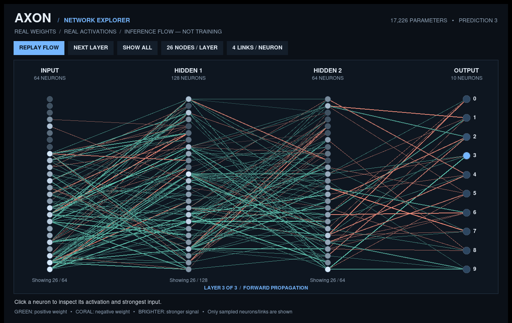

# AXON v2 — Neural Network From Scratch



A local macOS neural-network laboratory written in Python. **Forward propagation,
backpropagation, gradients, SGD, and Adam are implemented in NumPy**, not in
TensorFlow, PyTorch, scikit-learn, or pretrained model APIs.

## What's different in v2

The original AXON model uses **1,259 training images at 8×8 resolution** and
reported **97.77% accuracy on 269 held-out examples**. That metric is NOT the
accuracy of handwritten digits drawn in the app. The sample handwritten `6` that
was guessed as `4` is evidence that the small data distribution generalizes
poorly to a freehand digit.

v2 adds:

- A full-size **MNIST** pipeline using official **60,000 training** and
  **10,000 test** 28×28 digit images. 5,000 examples from the 60,000 are set
  aside for validation. The 10,000 test images remain completely untouched
  during training and model selection.
- A 784-input NumPy model with float32 forward/backward/optimization, optional
  2-pixel shift augmentation and early stopping on validation loss.
- A new drawing normalization procedure approximating MNIST's centered glyph
  within 28×28 pixels; camera/phone photo OCR is still not guaranteed.
- Uncertainty warnings for weak predictions. Softmax numbers are **not**
  probabilities of being correct.
- Save your own labeled drawings using **SAVE CORRECTION**, and adapt the model
  with `personalize`. Corrections are saved locally in `data/corrections/`.
- Dark, legible buttons on macOS; more flexible desktop layout and sample view.

### Install/upgrade on Mac

The ZIP includes a top-level `AXON-Neural-Network/` folder. If you're using
`~/Documents/projects/AXON-Neural-Network/AXON-Neural-Network`, place the ZIP
in `~/Documents/projects` and run:

```bash
cd "$HOME/Documents/projects" || exit 1
unzip -o AXON-v2.zip -d AXON-Neural-Network
cd AXON-Neural-Network/AXON-Neural-Network || exit 1
./.venv/bin/python -m axon train-mnist
./.venv/bin/python -m axon evaluate
./.venv/bin/python -m axon demo
```

The first `train-mnist` downloads approximately 11 MB of MNIST gzip archives
from Google's public MNIST mirror to `data/mnist/`. It then trains a NumPy-only
classifier from scratch. **The ZIP does not contain a trained MNIST model; the
new benchmark score is unknown until your Mac finishes training and evaluating**.
The original `models/digits.npz` remains as a fallback.

Re-running `train-mnist` retrains from a fresh random initialization and
replaces `models/mnist.npz`, without deleting the original 8×8 model.

### Drawing feedback

After training, use `demo`, draw a digit, press **PREDICT**, choose the **ACTUAL
DIGIT** (0–9) and press **SAVE CORRECTION**. Repeat with diverse examples. Then:

```bash
./.venv/bin/python -m axon personalize
./.venv/bin/python -m axon demo
```

The `personalize` command starts with `models/mnist.npz`, mixes your corrected
examples with a replay sample from the MNIST training split, and writes
`models/mnist_personal.npz`. That model is selected automatically by the demo,
while original MNIST weights are preserved. Feedback is not automatically
trained until `personalize` is executed. Use NEW drawings to test changes.

### Commands

```bash
./.venv/bin/python -m axon train-mnist --epochs 24 --augment 1
./.venv/bin/python -m axon evaluate
./.venv/bin/python -m axon inspect
./.venv/bin/python -m axon demo
./.venv/bin/python -m axon predict image.png
./.venv/bin/python -m axon personalize
./.venv/bin/python -m axon train
./.venv/bin/python -m axon xor
./.venv/bin/python -m pytest -q
```

You can force the original model using `--model models/digits.npz` or the MNIST
baseline using `--model models/mnist.npz`.

### Accuracy policy

**99.99% is not guaranteed or claimed.** On 269 test images, accuracy moves in
steps of 1/269 ≈ 0.372 percentage points; 99.99% would require **zero errors**
and therefore report as 100%. On the 10,000-image MNIST test split, 99.99%
would mean **at most one error**. An ordinary dense NumPy model is not expected
to achieve this. A strong but realistically variable goal is about 97–99% on
MNIST, and freehand drawings require a separate, representative test set.
Increasing the epoch count does not necessarily improve generalization.

### Project modules

- `axon/network.py` — layers, numerical backpropagation, Adam/SGD, save/load
- `axon/mnist.py` — MNIST IDX download/parser, train/val/test splits, augmentation
- `axon/data.py` — original scikit-learn 8×8 digits and XOR
- `axon/preprocess.py` — 8×8 and 28×28 input preprocessing
- `axon/gui.py` — macOS digit drawing interface with uncertainty feedback
- `axon/corrections.py` — save and load labeled freehand drawings
- `axon/cli.py` — training, testing, introspection, demo and personalization
- `axon/visuals.py` — training graphs, confusion matrices, learned weights

MIT licensed. All user corrections stay local unless you explicitly share them.

## Live Neural Network Explorer

AXON includes a native **VIEW LIVE NEURAL NETWORK** button alongside the digit
canvas. Draw a digit, select **PREDICT**, and open the explorer. It shows the
*actual* forward-pass activations computed by your model, not made-up animated
neurons. The layers correspond to the saved network (e.g. 784 → 128 → 64 → 10).

- **REPLAY FLOW** animates input → hidden layers → output probabilities.
- **NEXT LAYER** steps through the forward pass; **SHOW ALL** displays every layer.
- **26 / 36 NODES** changes how many neurons per large layer are rendered.
- **4 / 8 LINKS** changes the strongest rendered connections per neuron.
- **Click a neuron** to inspect activation, pre-activation, bias, and strongest
  individual incoming input contribution.
- **Green** links are positively weighted, **coral** links negatively weighted.
  Brightness corresponds to the signal (input activation × trained weight).
- Make another prediction in the main window to update the explorer with the
  new example's actual activations and class output.

**What is—and isn't—shown:** The fully-connected network may have hundreds of
thousands of individual parameters. The display deliberately samples the most
active units plus evenly distributed contextual neurons and visualizes only
strong incoming connections. Hidden/omitted units still participate in the
*real* forward propagation; the visualization does not approximate predictions.
It displays a trained model's **inference**, not live weight updates during
training. It requires Tkinter (bundled with many Python distributions).

### Publish AXON publicly on GitHub

The GitHub repository will be named **`siddhantkrishna/axon`**. Run this once
from your local AXON project directory:

```bash
bash publish_github.command
```

This checks/install GitHub CLI (via Homebrew when available), opens GitHub
browser authentication if needed, verifies that the logged-in account is
`siddhantkrishna`, stages only known public project files, commits them,
creates the **public** repository if absent, and pushes `main`. If the
repository already exists, it attempts a normal non-force push. It refuses to
replace a remote pointing somewhere else.

The downloaded MNIST data, personal drawing corrections, environment files,
and personalized/locally trained models are excluded. An original small 8×8
sample model is included for running the app immediately. GitHub Actions
runs the unit test suite on pushed commits and pull requests.
